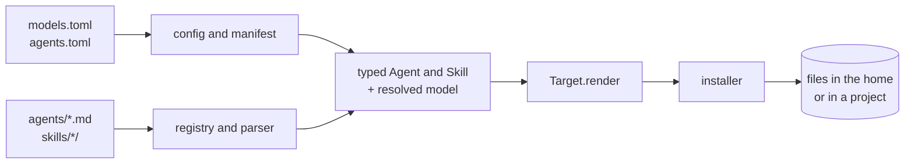
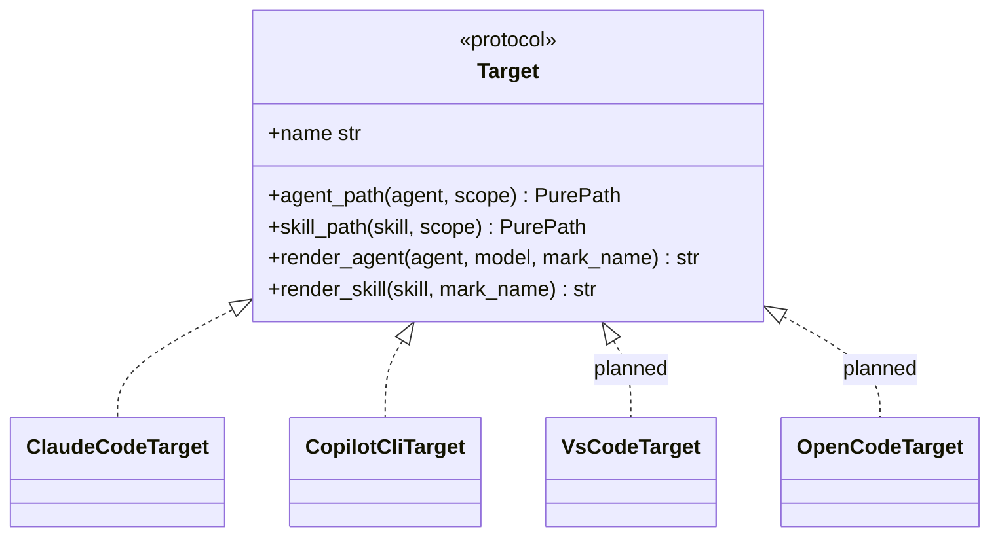

# Architecture

## Target layout

```
general-agents/
├── agents/                     # neutral descriptions, one .md per agent
├── skills/
│   ├── atomic-tasks/           # SKILL.md plus examples-*.md references
│   └── csh-pro/SKILL.md
├── install                     # thin executable: calls shuttle.cli.main()
├── models.toml                 # repository name and models per tool and agent
├── agents.toml                 # per-agent tools and tier
├── pyproject.toml
├── src/shuttle/
│   ├── __init__.py
│   ├── cli.py                  # arguments, dispatch, exit codes
│   ├── model.py                # dataclasses: Agent, Skill, ModelTier, ToolSet
│   ├── config.py               # reads models.toml, resolves the model per agent
│   ├── manifest.py             # reads agents.toml
│   ├── parser.py               # reads the plain Markdown sources
│   ├── mark.py                 # origin mark: key and detection
│   ├── registry.py             # discovers agents and skills
│   ├── targets/
│   │   ├── base.py             # Target interface
│   │   ├── claude_code.py
│   │   ├── copilot_cli.py
│   │   ├── vscode.py       # later
│   │   └── opencode.py     # later
│   ├── installer.py            # the only module that writes to disk
│   └── errors.py
├── tests/
├── docs/
├── .github/                    # CI workflow, issue and pull request templates
├── LICENSE
└── CONTRIBUTING.md
```

## Data flow


0. `config` reads `models.toml` and `manifest` reads `agents.toml`, both at the repository root.
1. `registry` walks `agents/` and `skills/`.
2. `parser` validates each Markdown source (name from the file name, description from the first paragraph) and, with the manifest entry, produces typed objects (`Agent`, `Skill`). Every source error is caught here.
3. Each `Target` turns a typed object and the resolved model into tool-specific file content and provides its install location.
4. `installer` writes (or simulates writing). It is the only module that touches the disk.

## Responsibilities

| Module | Responsibility | Does not |
|---|---|---|
| `manifest` | Read and validate `agents.toml` | Read the Markdown sources |
| `parser` | Validate and type the sources | Know about target tools |
| `config` | Read `models.toml`, resolve each agent's model for a tool | Write to disk |
| `model` | Represent agents, skills, model tiers, tool sets | Do I/O |
| `targets/*` | Tool-specific rendering and paths, mapping tables | Write to disk |
| `installer` | Writing, dry-run, origin mark (no deletion) | Know any tool's format |
| `cli` | User interface, exit codes | Business logic |

## `Target` interface



```python
class Target(Protocol):
    name: str

    def agent_path(self, agent: Agent, scope: Scope) -> PurePath: ...  # relative to home or project
    def skill_path(self, skill: Skill, scope: Scope) -> PurePath: ...
    def render_agent(self, agent: Agent, model: str, mark_name: str) -> str: ...
    def render_skill(self, skill: Skill, mark_name: str) -> str: ...
```

Each target holds its own mapping table from abstract tools to the platform's tool names. Model identifiers are no longer in the targets: they come from `models.toml` (see [install-spec.md](install-spec.md)).

## Constraints

- Python ≥ 3.11 (for `tomllib`), standard library only at runtime.
- Deterministic output: same input, same generated content (useful for tests and updates).
- No write outside the paths provided by the targets.
- Errors are typed (`errors.py`) and turned into clear messages and exit codes by `cli`.
