# Diagram lab (temporary)

A scratch page to see which Mermaid features GitHub renders. Open it on GitHub and note which blocks display a diagram and which show an error. It will be deleted once the diagram style is decided.

## 1. Frontmatter configuration with the hand-drawn look

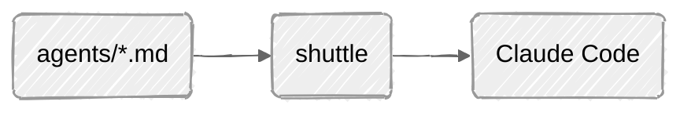

## 2. Neutral theme through frontmatter

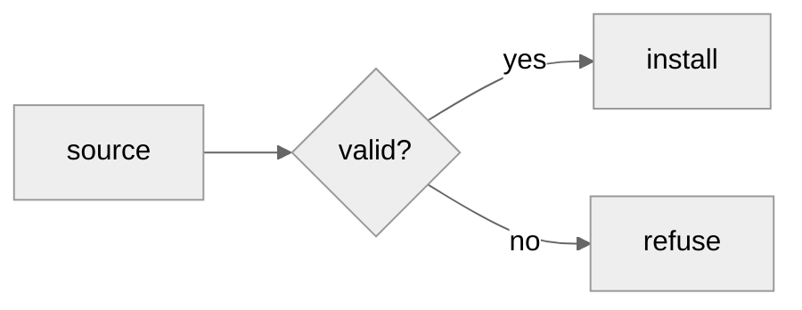

## 3. New node shapes (`@{ shape: ... }`)

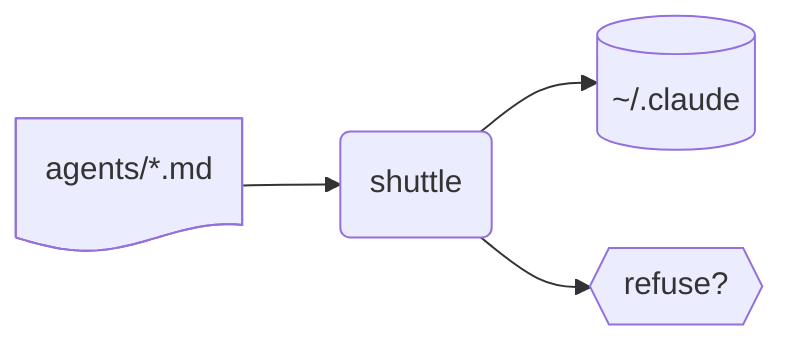

## 4. ELK layout

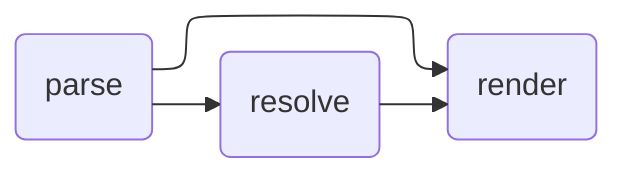

## 5. Architecture diagram with icons

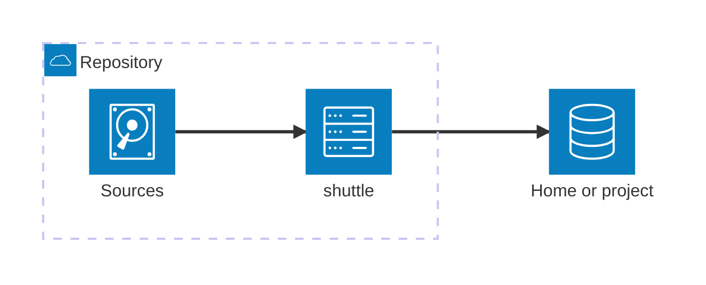

## 6. Block diagram

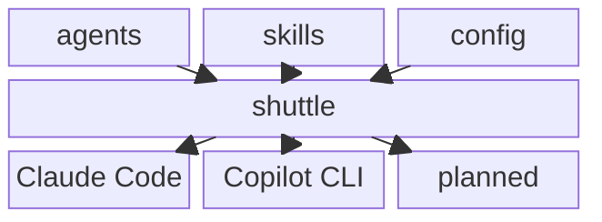

## 7. Kanban

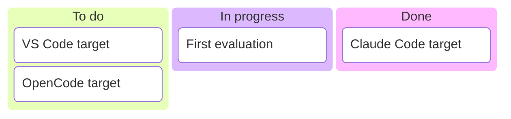

## 8. Timeline

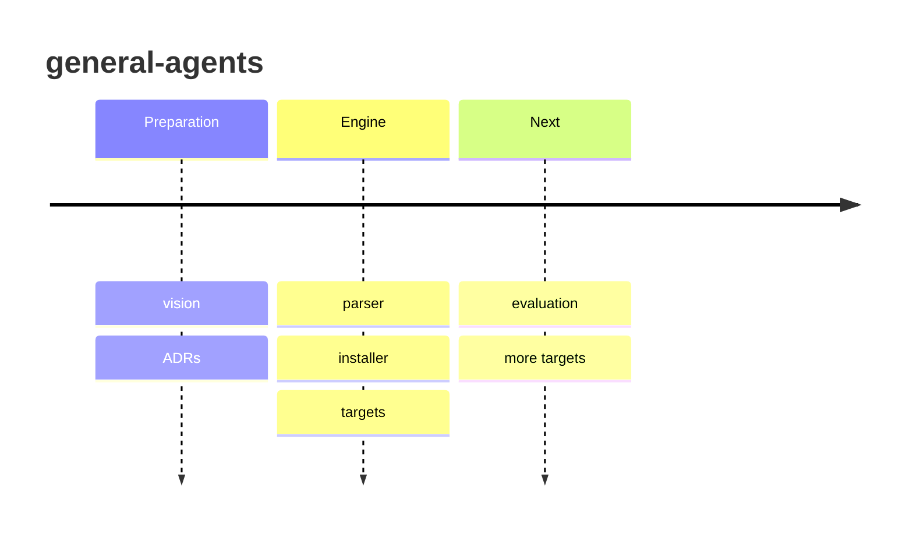

## 9. Mind map

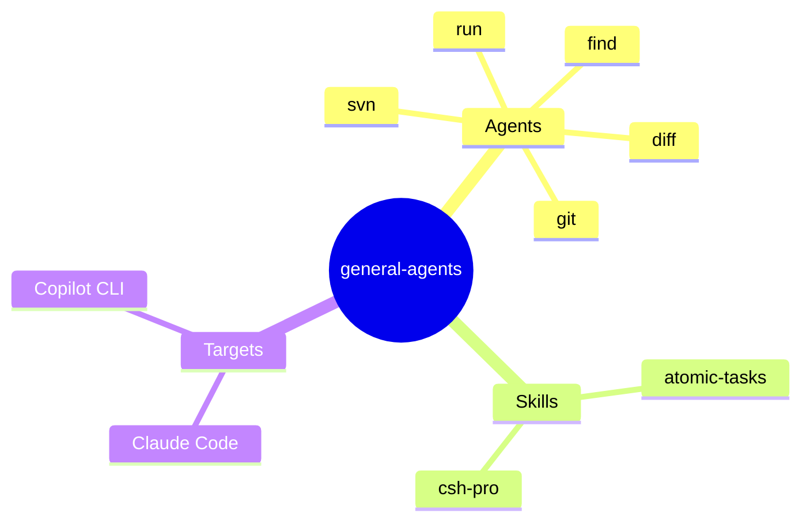

## 10. Quadrant chart

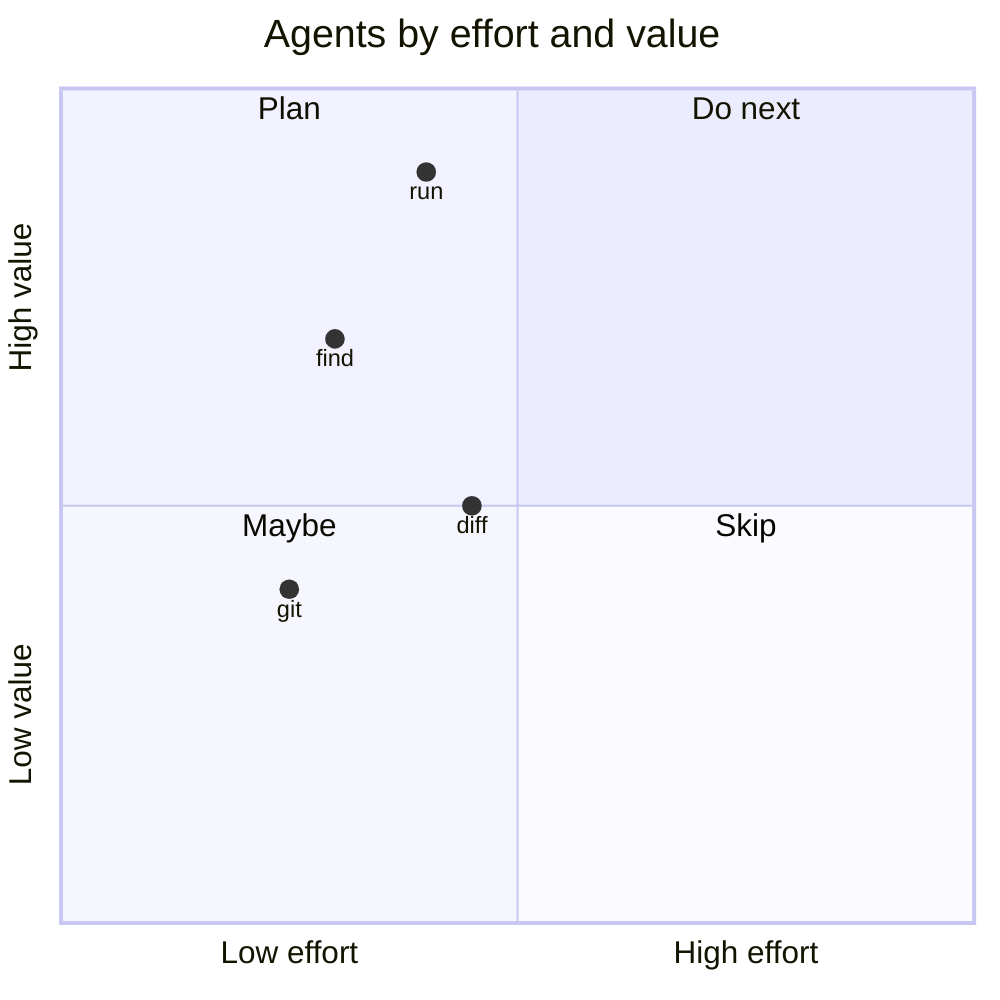

## 11. Pie

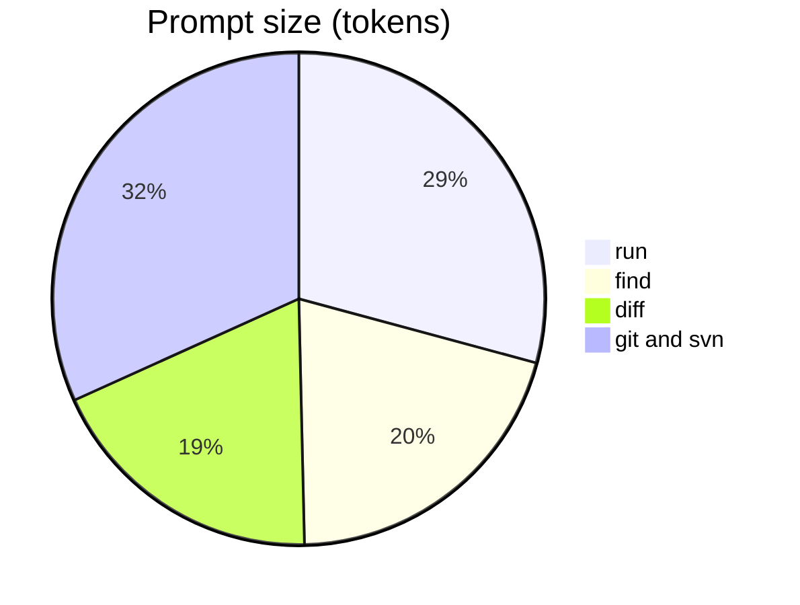

## 12. Gitgraph

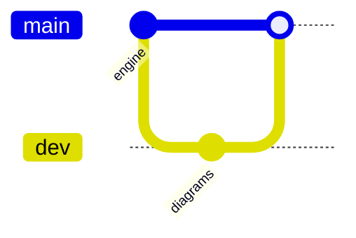

## 13. State diagram, hand-drawn

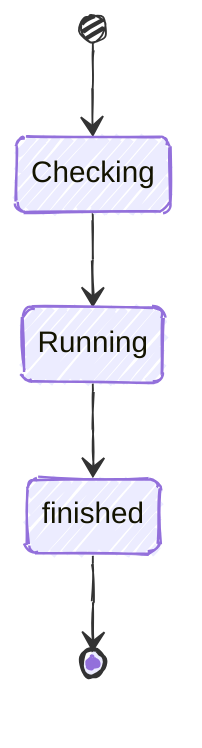
