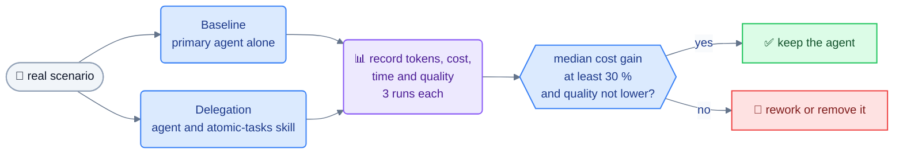

# Evaluation: measuring token savings

Without measurement, delegating can cost more than acting directly. Each agent must therefore justify its existence with numbers.

## Question

For a given task, is the total consumption (primary agent **plus** sub-agent) lower with delegation, at equal answer quality?

## Protocol

1. Choose a **real scenario** (example: run a project's failing test suite and identify the cause).
2. Run it twice, from the same state:
   - **Baseline**: the primary agent does everything itself.
   - **Delegation**: the primary agent has access to the evaluated agent and to the `atomic-tasks` skill.
3. Record, for each run:
   - input and output tokens of the primary agent;
   - input and output tokens of the sub-agent(s);
   - weighted cost according to the prices of the models used;
   - duration;
   - quality: is the answer correct and sufficient? (yes / partial / no).
4. Repeat at least 3 times per scenario to smooth out variance.

## Metrics

| Metric | Computation |
|---|---|
| Total tokens | primary + sub-agents |
| Weighted cost | sum (tokens × model price) |
| Cost gain | 1 − delegation cost / baseline cost |
| Quality rate | share of runs judged correct |

## Acceptance thresholds (proposed, to be confirmed)

- Median cost gain ≥ 30 % on the agent's target scenarios.
- Quality rate with delegation ≥ baseline quality rate.
- No target scenario where delegation costs more.

An agent below the threshold is reworked (output contract, prompt) or removed from the catalog.

## Starting scenarios

| Agent | Scenario |
|---|---|
| `run` | Tests or build with long output and a few real errors |
| `find` | Find all usages of an API in a medium-sized repository |
| `diff` | Summarize a change spanning several dozen files |
| `git` | Find the commit that introduced a regression |
| `svn` | Same on a Subversion repository |

## Organization

- Scenarios, measurements and conclusions are stored in `docs/evaluations/` (one file per agent and date).
- The way tokens are measured depends on the tool; it is noted in each results file.
- This evaluation is manual to begin with. Automation is considered only if it becomes a bottleneck.
