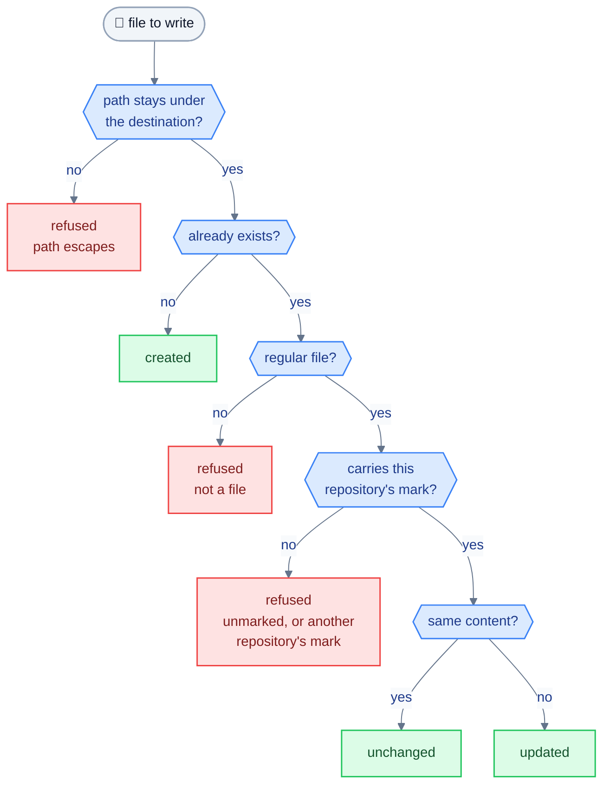

# `install` specification

`install` is a thin executable that calls `shuttle.cli.main()`. The package can also be used with `pip install -e .` (command `shuttle`).

## Usage

Targets available today: `claude-code`, `copilot-cli`. `vscode` and `opencode` will be added later (see [targets.md](targets.md)).

```
install --target {claude-code,copilot-cli} [--scope {user,project}] [--model AGENT=MODEL]... [--dry-run] [--yes] [--home PATH | --project PATH]
```

| Option | Effect |
|---|---|
| `--target` | **Required.** One tool per run. No default and no `all`: a missing `--target` is a usage error (code 3). |
| `--model AGENT=MODEL` | Repeatable. Sets the model of **one** agent for this run. Never applies to all agents. An unknown agent name is a usage error. |
| `--dry-run` | Shows every file that would be created or updated, without writing anything. |
| `--yes` | Do not ask for confirmation. Without it, `install` lists what it will write and asks `[y/N]`; without an interactive terminal it refuses to write (usage error, code 3). |
| `--scope` | `user` (default) installs in the home; `project` installs inside a project ([ADR 0011](decisions/0011-install-scope.md)). |
| `--home PATH` | User scope only: substitute home root (tests and trials). |
| `--project PATH` | Project scope only: project root, default the current directory. |

`--home` with `--scope project`, or `--project` with `--scope user`, is a usage error (code 3).

### Where files go

| Target | User scope | Project scope |
|---|---|---|
| `claude-code` | `~/.claude/agents/`, `~/.claude/skills/` | `<project>/.claude/agents/`, `<project>/.claude/skills/` |
| `copilot-cli` | `~/.copilot/agents/`, `~/.copilot/skills/` | `<project>/.github/agents/`, `<project>/.github/skills/` |

The installer writes only these agent and skill files. It never reads or modifies any other file of the destination, such as an existing instructions file.

## Models and `models.toml`

`models.toml` sits at the repository root, next to `agents/` and `skills/`. It is copied with the script from one repository to another.

```toml
name = "general-agents"     # identifies the repository in the origin mark

[defaults]
small = "claude-haiku-5-5"  # model for tier = small

[copilot-cli]
run = "claude-haiku-5-5"    # model of one specific agent for this tool

[vscode]
[opencode]
```

For a given agent and tool, the model is the first one found among:
1. the `--model AGENT=MODEL` option;
2. the `AGENT` key in the tool's section of `models.toml`;
3. the key of the agent's `tier` in `[defaults]`.

If none matches, `install` fails with a message naming the agent and the tool; it never picks a model at random. An unknown agent in `models.toml` or an unknown tool section is reported as a configuration error (code 2).

`install` cannot check that an identifier exists in the tool. It only checks its form (allowed characters, non-empty); the rest is up to the user. `--dry-run` shows the model chosen for each agent.

## Origin mark

Every generated file contains `managed-by: <name>`, where `<name>` is the `name` field of `models.toml` (see [targets.md](targets.md) for the form per tool). It is the **only** criterion by which `installer` considers a file as its own.

## Safety rules

1. **Never overwrite a file that is not ours.** If the destination exists without the mark, or marked by another repository name, the operation is refused for that file with an explicit message.
2. **Never delete any file.** `installer` exposes no deletion operation. An agent removed from the sources stays installed until the user deletes it by hand.
3. **Write only to paths returned by the targets**, resolved under the home root. Reject any path that would escape it (including through a symbolic link).
4. **Faithful dry-run**: same paths and same decisions as the real run, with no side effects.
5. **Atomic write**: write to a temporary file in the same folder, then rename.
6. **Idempotence**: rerunning `install` without any source change modifies nothing.

## Files written

For each agent, one file; for each skill, its `SKILL.md` plus each reference file next to it. Every file gets the origin mark (a key, or a first-line comment) and follows the same safety rules below.

## Possible actions per file



The same decision is made for a dry run and a real run; nothing is ever deleted.

| Destination state | Action |
|---|---|
| Absent | Create |
| Present, marked by this repository, identical content | None |
| Present, marked by this repository, different content | Update |
| Present, unmarked or marked by another name | Refuse, report |
| Present, not a regular file | Refuse, report |

## Output

One summary per file (`created`, `updated`, `unchanged`, `refused`), then a total. User-facing messages are in English.

## Exit codes

| Code | Meaning |
|---|---|
| 0 | Success |
| 1 | At least one file refused |
| 2 | Invalid source or configuration (agent, `models.toml`) |
| 3 | I/O or usage error |

## Chosen design

- No deletion by the script: neither `uninstall` nor `--remove` (ADR 0004). The user deletes by hand.
- Installation by transformed **copy**, not by symbolic link, because the content depends on the tool (ADR 0003).
