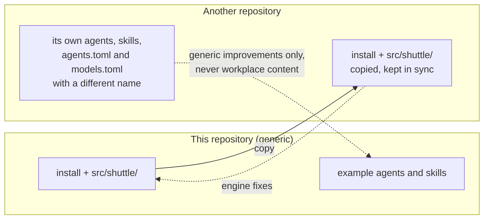

# Reusing shuttle in another repository

`shuttle` is designed to be **copied** into other repositories, each with its own agents (ADR 0007). Nothing is published as a package and nothing links the copies together.

## The picture



## What to copy

| Copy | Purpose |
|---|---|
| `install` | Entry point. It adds `src/` next to itself to the import path, so the copy runs in place. |
| `src/shuttle/` | The engine. It never needs editing for new agents. |
| `pyproject.toml` | Only for development (tests, `ruff`, `mypy`). `install` runs without it. |
| `tests/` | Optional. The engine tests run unchanged in a copy; the golden files only exercise the engine's own fixtures. |
| `.github/workflows/ci.yml` | Optional. |

## What to write in the new repository

| File | Content |
|---|---|
| `agents/<name>.md` | One plain Markdown prompt per agent, no frontmatter. The first paragraph is the description ([format](agent-format.md)). |
| `agents.toml` | One table per agent with its `tools` (and optionally `tier`). |
| `models.toml` | `name`, `[defaults]`, and optional per-tool sections. |
| `skills/<name>/SKILL.md` | Optional skills, also plain Markdown. |

Do not copy this repository's `agents/`, `agents.toml` or `skills/` blindly: they are generic examples. Anything specific to a workplace (tool names, error markers, script names, internal conventions) belongs in the other repository only.

## Checklist for a new copy

1. Copy the files above.
2. In `models.toml`, set a **different `name`**. It is written in the origin mark (`managed-by: <name>`) of every generated file; two repositories with the same name would be allowed to overwrite each other's files, and two with different names refuse to.
3. Avoid agent names that already exist in the home from another repository. A same-named file with another repository's mark is refused, never overwritten.
4. Run `./install --target <tool> --dry-run`, read the plan, then run it for real. Use `--scope project --project <dir>` to install inside a project instead of the home.
5. Optionally run `python -m pytest` in the copy to check the engine still works there.

## Keeping the engine in sync

The engine is the only shared part. When it changes here, update the other copies:

```sh
# from the other repository; SRC is the path of this repository
diff -ru "$SRC/src/shuttle" src/shuttle        # review the changes
cp -r "$SRC/src/shuttle/." src/shuttle/        # apply them
cp "$SRC/install" install
```

Check `pyproject.toml` for the version (`version = "0.1.0"` here) to know which engine a copy runs. There is no migration step: the format of `agents/`, `agents.toml` and `models.toml` is the engine's contract, and changes to it are recorded as ADRs in [decisions/](decisions/README.md); read the ones newer than your copy before updating.

## Copying content back

Copy generic improvements (a better prompt for `find`, a new target) from a work copy back here only after removing everything that identifies the workplace: names, paths, tool messages, internal scripts.
