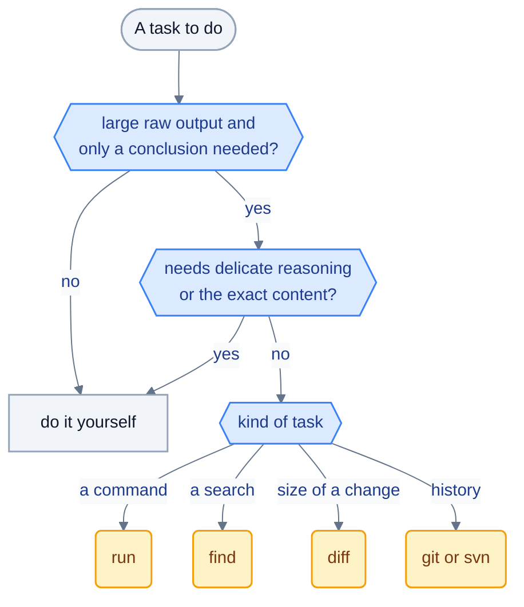

# `atomic-tasks` skill

Target file: `skills/atomic-tasks/SKILL.md`.

## Role

Tell the primary agent **when** to delegate to a sub-agent of the catalog and **how** to do it, so that delegation stays worthwhile.

## Decision principle



Delegate if the expected raw output is large **and** only a conclusion is useful. Do not delegate if the primary agent needs the exact content for what follows, or if the operation is trivial.

## Decision table (content to carry into the skill)

| Situation | Decision |
|---|---|
| Running a command with long or lengthy output (simulation, build, regression) | Delegate to `run`, giving it the exact command in your shell's syntax writing to a log file, and a timeout |
| Finding where a notion appears in a large repository | Delegate to `find` |
| Reading a small file, or a few precise lines | Do not delegate, read directly |
| Writing or modifying a file | Do not delegate |
| Understanding the extent of a change between two revisions | Delegate to `diff` |
| Finding who or what introduced a change | Delegate to `git` or `svn` |
| Short command whose output fits in a few lines | Do not delegate |
| Task requiring delicate reasoning | Do not delegate: the sub-agents run on tiny models |

## Invocation instructions

For each delegation, the primary agent must:
1. Ask a **precise question** ("which tests fail and why?"), not a vague instruction.
2. Provide the **minimal context**: path, command, references. For `run`, the exact command written for the primary agent's own shell (and the shell's name), redirecting its output to a log file (`command >& job.log` in csh, `command > job.log 2>&1` in bash or zsh), **and a timeout in seconds** chosen from the expected duration of the job; `run` does not interpret the command, filters the log instead of reading it whole, and refuses to run without a timeout.
3. State the **expected format** if it differs from the default contract.
4. **Not** copy large contents into the prompt.

## After the answer

- Trust the verdict, but verify before any irreversible action.
- If the answer reports `truncated: yes` or uncertainties, relaunch with a more targeted question rather than rereading the raw content.
- Do not relaunch a sub-agent on the same question without new information.

## Structure: a short skill and one examples file per agent

The skill is split ([ADR 0010](decisions/0010-skill-references-and-shared-agent-rules.md)): `SKILL.md` holds the decision principle, the table, how to phrase a request, what to do after the answer, the list of cases not to delegate, and links to reference files. The worked sequences live next to it, one file per agent, so that a consultation loads about 730 tokens instead of about 1,900:

`examples-run.md`, `examples-find.md`, `examples-diff.md`, `examples-git-svn.md`, `examples-combined.md`.

## Example sequences

The reference files hold worked sequences, because a decision table alone does not show how a delegation flows. They are grouped by sub-agent (`run`, `find`, `diff`, `git`, `svn`), followed by sequences combining agents and a list of cases not to delegate. Each shows the request as the primary agent should write it, the shape of the reply, and the next step.

Rules for writing them:
- Keep them generic: no project-specific names, no proprietary tool commands.
- One scenario per entry, two to four sentences.
- Every agent has at least three entries, including its failure modes (timeout, blocked, no match).
- The cost is real: the skill is loaded into the primary agent's context. When it grows too long, keep the most instructive entry per agent and move the rest to documentation.

## File structure

Plain Markdown with no frontmatter (ADR 0008). The name is the folder name and the description is the first paragraph:

```markdown
When and how to delegate voluminous tasks (execution, search, diff, history) to small sub-agents. Consult before running a command with long output or a wide search.

# When to delegate
...
# Decision table
...
# How to phrase the request
...
# After the answer
...
# Example sequences
...
```

## Companion skill: `csh-pro`

`skills/csh-pro/SKILL.md` is a reference for writing csh and tcsh commands and scripts: a bash-to-csh translation table, verified pitfalls (unmatched globs abort, loops must start their own line, `@` needs spaces, `\$` does not escape in double quotes, pipeline status) and when to switch to Python or bash. Its facts were checked against tcsh. It exists because models drift to bash syntax in csh, which also breaks the commands handed to `run`.

Only the primary agent loads it, when it writes csh. It is deliberately not preloaded into `run`: preloading injects the full skill on every call, which costs more than the shell table `run` already carries. Workplace-specific conventions (script names, environment setup) belong in the other repository's own skill, not here.

## Constraints

- Stay short: the skill is loaded into the primary agent's context; every line has a cost.
- Refer to agents by their catalog name, never by a platform tool name.
- Update it whenever an agent is added or a boundary changes (see [agents-catalog.md](agents-catalog.md)).
