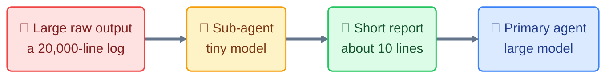

# Vision

## Problem

Primary coding agents spend many tokens on tasks where they only need the conclusion: reading build logs, browsing a repository, summarizing a git history. These tasks could be handed to a smaller, cheaper model.

## The idea

## Goal

Provide a set of **small sub-agents** that condense information, use the **smallest models possible**, and are **defined once** then adapted to several agentic tools.

## Principles

0. **Tiny models by default.** The `small` tier is the only one that exists (ADR 0006) and points to the smallest available model; the user can replace it agent by agent in `models.toml` or with `--model` (ADR 0007). Tasks that require delicate reasoning stay with the primary agent.
1. **Condense, don't just delegate.** A sub-agent is only worth it if it returns far less than it consumed.
2. **One source format.** Agents are described neutrally in `agents/`. The `shuttle` package adapts them to each tool.
3. **Safe by default.** Read-only unless necessary. The installer never overwrites a file that does not belong to the project.
4. **Measurable.** Each agent must be evaluable by comparing tokens with and without delegation (see [evaluation.md](evaluation.md)).
5. **No runtime dependency.** Python standard library only.

## Scope

- Agents: `run`, `find`, `diff`, `git`, `svn` (see [agents-catalog.md](agents-catalog.md)).
- `atomic-tasks` skill telling the primary agent when and how to delegate, and a `csh-pro` skill for writing csh and tcsh correctly.
- Reuse by copying the script into other repositories ([reuse.md](reuse.md)).
- Python package `shuttle` and `install` executable.
- Target tools: Claude Code and Copilot CLI first; VS Code and OpenCode later.

## Out of scope

- `read`, `list`, `glob` agents: redundant with the primary agent's native tools.
- `write` agent: the primary agent must already supply the whole content, which doubles the cost.
- `backup`: deterministic operation, a job for a script rather than an LLM.
- Any file deletion by the script (`uninstall`, `--remove`): judged too risky, removal is done by hand (see [install-spec.md](install-spec.md) and ADR 0004).
- Complex multi-agent orchestration, memory shared between sub-agents.

## Success criteria

- On real cases, delegation reduces the primary agent's total token consumption without degrading answer quality.
- Adding a target tool amounts to adding one file.
- Adding an agent amounts to adding one Markdown file and one table in `agents.toml`.
- Agents work in any shell, not only the author's.
- `install --dry-run` describes exactly what will be written.
